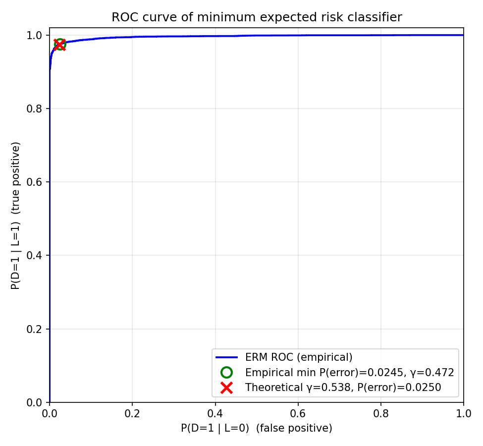
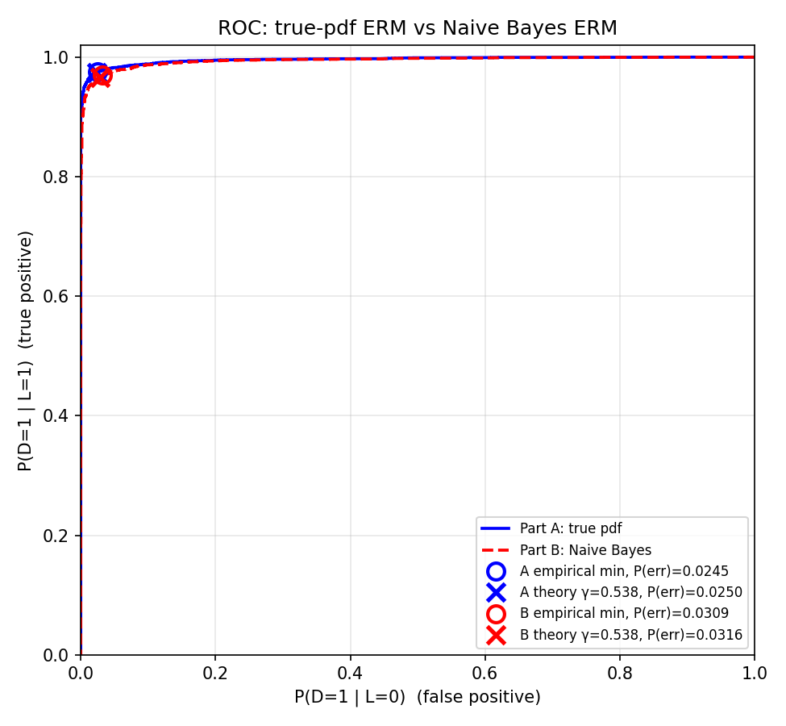
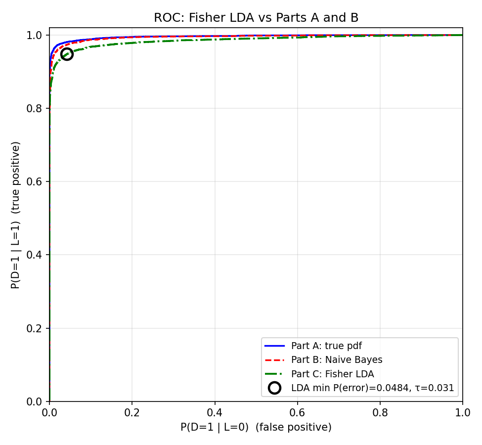
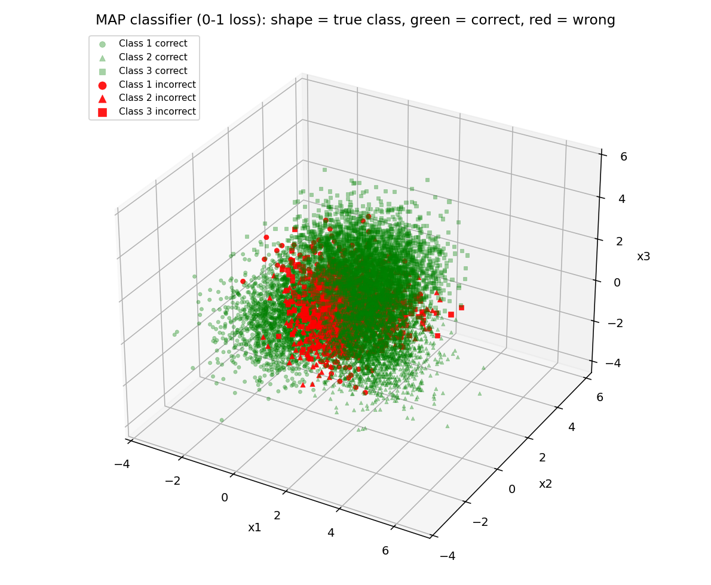
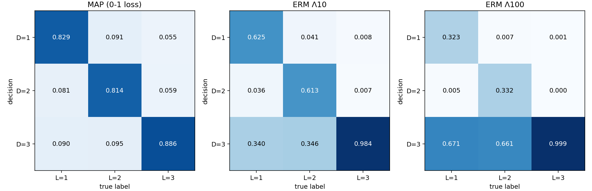
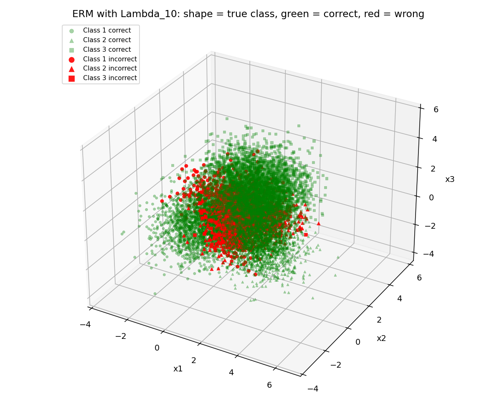
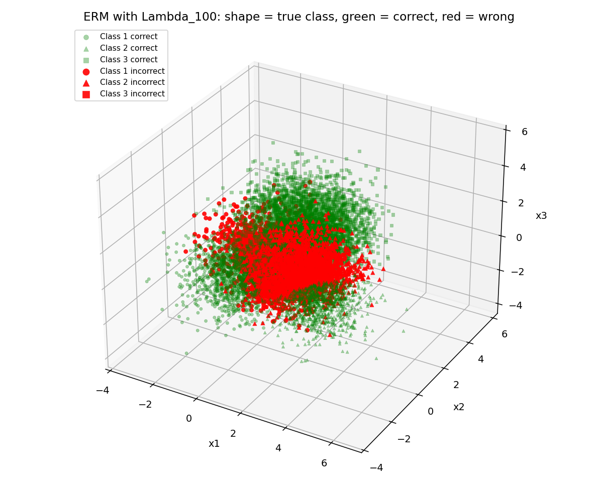
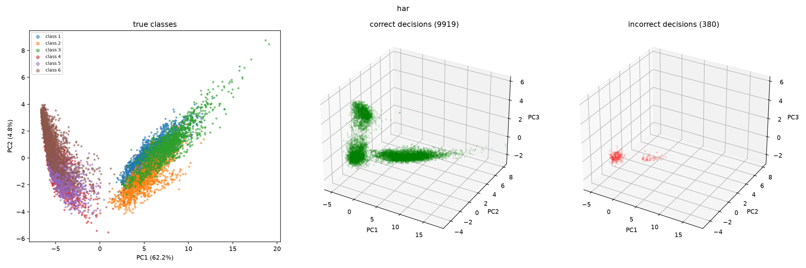
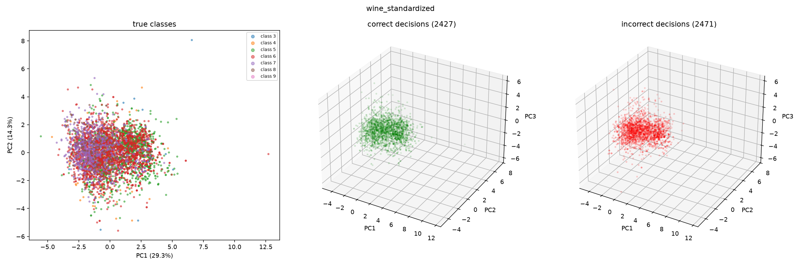

# Homework Report: Questions 1, 2 and 3

Jae Young Seo

### [My code](https://github.com/Jae-YS/EECE5644_Assignment1)

All figures are in the `report_figures/` folder next to this file. Code files: `part_a_erm.py`, `part_b_nb.py`, `part_c_lda.py` (Question 1), `q2_map_erm.py` (Question 2), `q3_gaussian_classifier_simple.py` (Question 3).

I used Claude (Sonnet 5.5, Anthropic) as an AI assistant on this assignment. Specifically, for visualization, data generation, and classifer layout. It also helped with the structure and wording of the written report and its tables.

---

# Question 1:

## Data

The 4-D random vector **X** has the pdf p(**x**) = p(**x**|L=0)P(L=0) + p(**x**|L=1)P(L=1), with priors P(L=0) = 0.35 and P(L=1) = 0.65, and class-conditional Gaussians g(**x**|**m**_0, **C**_0) and g(**x**|**m**_1, **C**_1), where **m**_0 = (−½, −½, −½, −½)ᵀ, **m**_1 = (1, 1, 1, 1)ᵀ,

**C**_0 = ¼ [[2, −0.5, 0.3, 0], [−0.5, 1, −0.5, 0], [0.3, −0.5, 1, 0], [0, 0, 0, 2]], &nbsp; **C**_1 = [[1, 0.3, −0.2, 0], [0.3, 2, 0.3, 0], [−0.2, 0.3, 1, 0], [0, 0, 0, 3]].

I generated N = 10,000 samples (random seed 0) by drawing each label from the priors and then drawing **x** from the corresponding Gaussian, keeping the true labels. This gave 3538 samples of class 0 and 6462 of class 1. The same data set was used in all three parts.

## Part A: ERM classification with the true pdf

**A.1 Decision rule.** Let λ_ij be the loss for deciding D=i when the true label is j. The conditional risks are R(D=i|**x**) = Σ_j λ_ij P(L=j|**x**). Deciding D=1 is preferred when R(D=1|**x**) < R(D=0|**x**), that is, (λ₁₀ − λ₀₀) P(L=0|**x**) < (λ₀₁ − λ₁₁) P(L=1|**x**). Applying Bayes' rule and rearranging gives the likelihood-ratio test

p(**x**|L=1) / p(**x**|L=0) > γ ⇒ D=1, otherwise D=0, &nbsp; with γ = [(λ₁₀ − λ₀₀) / (λ₀₁ − λ₁₁)] · [P(L=0) / P(L=1)].

For 0-1 loss, γ = 0.35/0.65 ≈ **0.5385**, which also minimizes P(error).

**A.2 ROC curve.** I computed the log-likelihood ratio ln[p(**x**|1)/p(**x**|0)] for every sample using the true Gaussians, sorted the samples by score, and swept γ from 0 to ∞ using thresholds between consecutive scores. At each γ, P(D=1|L=1;γ) and P(D=1|L=0;γ) were estimated as the fraction of class-1 and class-0 samples above the threshold, and P(D=0|L=1;γ) and P(D=1|L=0;γ) were stored for later use. The curve starts at (1, 1) for γ=0 and reaches (0, 0) at a finite γ.

*Figure 1: ROC curve of the ERM classifier (true pdf), with the empirical min-P(error) point (green circle) and the theoretical-threshold point (red ×).*

**A.3 Minimum probability of error.** P(error;γ) = P(D=1|L=0;γ)·0.35 + P(D=0|L=1;γ)·0.65 was evaluated for every γ.

| | γ | P(D=1\|L=0) | P(D=1\|L=1) | P(error) |
|---|---|---|---|---|
| Empirical minimizer | 0.4719 | 0.0249 | 0.9757 | **0.0245** |
| Theoretical γ = P(L=0)/P(L=1) | 0.5385 | 0.0235 | 0.9742 | 0.0250 |

The estimated minimum probability of error is about **0.0245** (2.5%). The empirical γ (0.47) is close to the theoretical γ (0.54), and the error rates differ by only about 0.0005 (roughly 5 of 10,000 samples). They differ slightly because the empirical threshold is tuned to this finite sample, and near the optimum the error curve is very flat. The empirical minimum is also slightly optimistic, since the threshold was chosen on the data used to evaluate it.

## Part B: ERM with a mismatched (Naive Bayes) model

The classifier uses the correct priors and means but assumes diagonal covariances with the true variances: **C**_0^NB = diag(0.5, 0.25, 0.25, 0.5) and **C**_1^NB = diag(1, 2, 1, 3). The rule and the threshold formula are the same as in Part A (γ = 0.5385 for 0-1 loss), but the likelihood ratio uses the Naive Bayes densities. The same ROC and error computations were repeated on the same 10,000 samples.

*Figure 2: ROC of the true-pdf ERM classifier (blue) and the Naive Bayes ERM classifier (red dashed). Circles mark the empirical minima and × marks the theoretical threshold.*

| | γ | P(D=1\|L=0) | P(D=1\|L=1) | P(error) |
|---|---|---|---|---|
| Naive Bayes, empirical minimizer | 0.4302 | 0.0322 | 0.9698 | **0.0309** |
| Naive Bayes, theoretical γ | 0.5385 | 0.0280 | 0.9664 | 0.0316 |

**Did the mismatch hurt?** Yes. The minimum P(error) rises from 0.0245 to 0.0309 (an increase of about 0.0064, or 26% in relative terms, about 64 extra errors per 10,000 samples), and the AUC falls from 0.9958 to 0.9944. 

## Part C: Fisher LDA

The class means and covariances were estimated from the 10,000 samples with sample averages (for example, **μ̂**_0 = (−0.509, −0.490, −0.514, −0.494)ᵀ and **μ̂**_1 = (1.019, 1.031, 0.986, 0.999)ᵀ, close to the true values). With equal class weights, the scatter matrices are **S**_B = (**μ̂**_1 − **μ̂**_0)(**μ̂**_1 − **μ̂**_0)ᵀ and **S**_W = **Ĉ**_0 + **Ĉ**_1. The Fisher direction maximizes J(**w**) = (**w**ᵀ**S**_B**w**) / (**w**ᵀ**S**_W**w**) and is the generalized eigenvector of **S**_B **w** = λ **S**_W **w** with the largest eigenvalue (λ ≈ 4.84), which is proportional to **S**_W⁻¹(**μ̂**_1 − **μ̂**_0):

**w**_LDA ≈ (0.609, 0.288, 0.699, 0.239)ᵀ (unit length).

The rule **w**_LDA^T **x** > τ ⇒ D=1 was applied with τ swept from −∞ to ∞, and P(error) was computed using the sample-count class proportions.

*Figure 3: ROC of Fisher LDA (green dash-dot) with its minimum-P(error) point (black circle), compared with Part A (blue) and Part B (red dashed).*

The minimum P(error) of LDA is **0.0484** (484 errors out of 10,000) at τ ≈ 0.031, where P(D=1|L=0) ≈ 0.0415 and P(D=1|L=1) ≈ 0.9478.

**Comparison of the three classifiers**

| Classifier | Model knowledge | Min P(error) | AUC |
|---|---|---|---|
| Part A: ERM, true pdf | true means and covariances | **0.0245** | 0.9958 |
| Part B: ERM, Naive Bayes | true means, diagonal covariances | 0.0309 | 0.9944 |
| Part C: Fisher LDA | sample estimates, linear projection | 0.0484 | 0.9854 |

LDA performs worst, with about twice the error of the optimal classifier. LDA also uses only the class means and a pooled scatter, so it ignores the difference between the class covariances. Naive Bayes keeps the class-specific variances, which is why it beats LDA even though it ignores the correlations. The sample estimates are close to the true values, so the gap comes from the linear form of the classifier, not from estimation error.

---

# Question 2: 

## Data distribution

Class 1 is Gaussian component a, class 2 is component b, and class 3 is an equal-weight mixture of components c and d, so p(**x**|L=3) = 0.5 g(**x**|**m**_c, **C**_c) + 0.5 g(**x**|**m**_d, **C**_d). The priors are 0.3, 0.3 and 0.4.

| Component | Class | Mean | Covariance |
|---|---|---|---|
| a | 1 | (0, 0, 0) | [[1.0, 0.3, 0], [0.3, 1.0, 0.2], [0, 0.2, 1.0]] |
| b | 2 | (2.5, 0, 0) | [[1.2, −0.3, 0], [−0.3, 0.8, 0], [0, 0, 1.0]] |
| c | 3 | (1.25, 2.5, 0) | [[0.9, 0, 0.3], [0, 1.1, 0], [0.3, 0, 1.0]] |
| d | 3 | (1.25, 1.0, 2.5) | [[1.0, 0.2, −0.2], [0.2, 1.2, 0], [−0.2, 0, 0.8]] |

The average standard deviation of the components is about 1.0, and the distances between pairs of means are between 2.5 and 2.97, i.e. about 2.5 to 3 standard deviations, which gives significant overlap.

## Part A: minimum probability of error (MAP) classifier

**A.1 Data.** 10,000 samples were generated (3021 of class 1, 2940 of class 2, 4039 of class 3), drawing each label from the priors, choosing component c or d with probability 0.5 each for class 3, and keeping the true labels.

**A.2 Rule and confusion matrix.** With 0-1 loss, the rule is D = argmax_j P(L=j|**x**) = argmax_j p(**x**|L=j) P(L=j). Applied to the 10,000 samples, the estimated confusion matrix P(D=i|L=j) (columns sum to 1) is:

| | L=1 | L=2 | L=3 |
|---|---|---|---|
| **D=1** | 0.8285 | 0.0912 | 0.0547 |
| **D=2** | 0.0814 | 0.8136 | 0.0594 |
| **D=3** | 0.0900 | 0.0952 | 0.8859 |

The overall probability of error is **0.1527**.

**A.3 Visualization.**

*Figure 4: MAP classification of the 10,000 samples. Marker shape shows the true class (circle = 1, triangle = 2, square = 3); green = correct, red = incorrect.*

The errors concentrate in the central region where the class-conditional pdfs overlap.

## Part B: ERM with loss matrices

For a loss matrix **Λ** with entries λ_ij, the minimum expected risk rule is D = argmin_i Σ_j λ_ij P(L=j|**x**). With 0-1 loss it reduces to the MAP rule (verified numerically). The matrices **Λ**_10 and **Λ**_100 penalize mistakes when L=3 by 10 and 100 times. The minimum expected risk was estimated as the average loss over the 10,000 samples.

| Λ₁₀: P(D=i\|L=j) | L=1 | L=2 | L=3 |
|---|---|---|---|
| **D=1** | 0.6246 | 0.0415 | 0.0084 |
| **D=2** | 0.0357 | 0.6129 | 0.0072 |
| **D=3** | 0.3396 | 0.3456 | 0.9844 |

| Λ₁₀₀: P(D=i\|L=j) | L=1 | L=2 | L=3 |
|---|---|---|---|
| **D=1** | 0.3234 | 0.0071 | 0.0007 |
| **D=2** | 0.0053 | 0.3316 | 0.0002 |
| **D=3** | 0.6713 | 0.6612 | 0.9990 |

| Loss | Min expected risk (ERM) | Risk of the MAP rule under the same loss | P(error) of ERM | Decisions D=1 / 2 / 3 |
|---|---|---|---|---|
| 0-1 (Part A) | 0.1527 | 0.1527 | 0.1527 | 2992 / 2878 / 4130 |
| Λ₁₀ | **0.2902** | 0.5676 | 0.2335 | 2043 / 1939 / 6018 |
| Λ₁₀₀ | **0.4409** | 4.7166 | 0.4013 | 1001 / 992 / 8007 |

*Figure 5: Confusion matrices P(D=i|L=j) for the MAP classifier and the two ERM classifiers.*

*Figure 6: ERM classification with Λ₁₀ (same markers and colors as Figure 4).*

*Figure 7: ERM classification with Λ₁₀₀.*

**Insights.**

- As the cost of missing class 3 grows, the class-3 decision region expands into the regions of classes 1 and 2. The number of class-3 decisions rises from about 4130 (MAP) to 6018 and 8007. Scaling the class-3 column of **Λ** by λ acts like inflating the prior of class 3 by that factor.
- The cost falls on classes 1 and 2: P(D=3|L=3) rises from 0.886 to 0.984 and 0.999, but P(D=3|L=1) rises from 0.090 to 0.340 and 0.671, and P(D=3|L=2) from 0.095 to 0.346 and 0.661.
- The ERM classifiers have a higher P(error) than MAP (0.2335 and 0.4013 versus 0.1527) but a lower expected risk. Under the Λ₁₀₀ loss, the MAP classifier would have a risk of 4.72, about 10 times the 0.44 of the ERM rule. Minimizing the error probability and minimizing the risk are different goals when the costs are unequal.

---

# Question 3:

## Model, estimation and decision rule

Let **x** ∈ ℝ^d be the features and L the class label. Each class-conditional pdf is assumed to be Gaussian with its own covariance, p(**x**|L=j) = g(**x**|**μ**_j, **C**_j), training samples are assumed independent, and the loss is 0-1. The datasets are **Wine Quality (white)**, N = 4898, d = 11, quality classes 3 to 9, and **HAR**, N = 10,299 (train and test pooled), d = 561, six activities.

From the n_j samples of class j (N in total): μ̂_j = (1/n_j) Σ **x**, Ĉ_j = (1/(n_j−1)) Σ (**x**−μ̂_j)(**x**−μ̂_j)ᵀ, P̂(L=j) = n_j / N. The wine priors for classes 3 to 9 are 0.0041, 0.0333, 0.2975, 0.4488, 0.1797, 0.0357, 0.0010, and the HAR priors for classes 1 to 6 are 0.1672, 0.1499, 0.1365, 0.1725, 0.1851, 0.1888.

**Regularization.** Ĉ_j is singular when n_j ≤ d (wine class 9 has 5 samples in 11 dimensions, rank 4), and the HAR covariances are rank-deficient (rank 466 to 469 of 561, condition number about 10¹⁶) because many features are correlated or nearly constant. I used **C**_reg,j = Ĉ_j + λ_j **I** with λ_j = α · (mean of the non-zero eigenvalues of Ĉ_j). Since Ĉ_j is positive semi-definite, every eigenvalue of **C**_reg,j is at least λ_j > 0, so the matrix is invertible (the HAR condition numbers fall to about 10⁴). The main results use α = 0.01. Wine features have very different scales (variance about 10³ for total sulfur dioxide versus 10⁻⁶ for density), and λ**I** is not scale-invariant, so I report wine on z-scored features as the main result and on raw features for comparison. The HAR features are already in [−1, 1].

**Decision rule.** The minimum-P(error) (MAP) rule is

D(**x**) = argmax_j [ ln P̂(L=j) − ½ (**x**−μ̂_j)ᵀ **C**_reg,j⁻¹ (**x**−μ̂_j) − ½ ln |**C**_reg,j| ],

with quadratic boundaries. It was applied to all training samples, P̂(error) is the fraction with D ≠ L, and the confusion matrix estimates P(D=i|L=j) = #(D=i, L=j)/n_j.

## Results

**Error probability estimates (training samples, α = 0.01)**

| Dataset | P̂(error) | Errors | Reference |
|---|---|---|---|
| Wine, standardized (main) | **0.5045** | 2471 / 4898 | always guessing class 6 gives 0.5512 |
| Wine, raw | 0.6933 | 3396 / 4898 | |
| HAR | **0.0369** | 380 / 10299 | |

**Confusion matrix, wine standardized** (counts; rows = decision D, columns = true label L)

| | L=3 | L=4 | L=5 | L=6 | L=7 | L=8 | L=9 |
|---|---|---|---|---|---|---|---|
| **D=3** | 8 | 3 | 10 | 2 | 0 | 0 | 0 |
| **D=4** | 2 | 39 | 48 | 28 | 2 | 0 | 0 |
| **D=5** | 3 | 70 | 804 | 461 | 27 | 3 | 0 |
| **D=6** | 4 | 39 | 436 | 909 | 192 | 47 | 0 |
| **D=7** | 2 | 11 | 158 | 782 | 647 | 110 | 0 |
| **D=8** | 1 | 1 | 1 | 16 | 12 | 15 | 0 |
| **D=9** | 0 | 0 | 0 | 0 | 0 | 0 | 5 |

The correct-decision rates P(D=j|L=j) for classes 3 to 9 are 0.40, 0.24, 0.55, 0.41, 0.74, 0.09 and 1.00. For raw wine, 3275 of the 4898 samples are assigned to class 7.

**Confusion matrix, HAR** (counts; rows = decision D, columns = true label L)

| | L=1 | L=2 | L=3 | L=4 | L=5 | L=6 |
|---|---|---|---|---|---|---|
| **D=1** | 1721 | 0 | 0 | 0 | 0 | 0 |
| **D=2** | 1 | 1544 | 48 | 0 | 0 | 0 |
| **D=3** | 0 | 0 | 1358 | 0 | 0 | 0 |
| **D=4** | 0 | 0 | 0 | 1446 | 0 | 0 |
| **D=5** | 0 | 0 | 0 | 331 | 1906 | 0 |
| **D=6** | 0 | 0 | 0 | 0 | 0 | 1944 |

The 380 errors are 331 class-4 samples decided as class 5 (18.6% of class 4), 48 class-3 samples decided as class 2 (3.4%), and 1 class-1 sample decided as class 2.

**Training error versus α**

| α | 10⁻⁶ | 10⁻⁴ | 10⁻³ | 10⁻² | 10⁻¹ | 1 |
|---|---|---|---|---|---|---|
| Wine, raw | 0.5102 | 0.5041 | 0.6002 | 0.6933 | 0.7556 | 0.7871 |
| Wine, standardized | 0.5002 | 0.5006 | 0.5031 | 0.5045 | 0.5159 | 0.5561 |
| HAR | 0.0166 | 0.0022 | 0.0083 | 0.0369 | 0.0898 | 0.2952 |

## Visualization

*Figure 8: HAR samples projected onto the first principal components. Left: PC1 vs PC2 colored by true class. Middle and right: first three PCs, with the 9919 correct and the 380 incorrect decisions shown separately.*

The first principal component (62.2% of the variance) separates the activities into the static group (classes 4 to 6, left) and the moving group (classes 1 to 3, right). Class 6 forms a compact cluster at the far left, classes 4 and 5 overlap heavily, and classes 1, 2 and 3 overlap in an elongated band. The 380 errors form two small localized clusters, one in the static region and one at the start of the moving band, which matches the confusion matrix. The overlap in this 2-D view is larger than the classifier's real error, because two components keep only about 67% of the variance and the classifier uses all 561 features.

*Figure 9: Standardized wine samples projected onto the first principal components, with the 2427 correct and 2471 incorrect decisions shown separately.*

For wine, all quality classes lie in one dense overlapping cloud (the first two components explain only 43.6% of the variance), with only a weak trend (class 7 toward negative PC1, class 5 toward positive PC1). The correct and incorrect decisions occupy the same region with similar spread, so the errors are not confined to any part of the cloud, which is consistent with the heavy class overlap and the 0.5045 error rate.

## Discussion

For a Gaussian, skewness is 0. Averaged over the features:

| Wine class | 3 | 4 | 5 | 6 | 7 | 8 | 9 |
|---|---|---|---|---|---|---|---|
| mean abs. skew | 0.89 | 1.28 | 1.01 | 1.36 | 0.79 | 0.99 | 0.79 |
| mean excess kurtosis | 1.1 | 5.1 | 3.6 | 7.3 | 1.9 | 2.3 | −0.7 |

| HAR class | 1 | 2 | 3 | 4 | 5 | 6 |
|---|---|---|---|---|---|---|
| mean abs. skew | 1.25 | 1.26 | 1.31 | 5.53 | 4.86 | 6.27 |
| mean excess kurtosis | 5.5 | 4.8 | 5.7 | 79.7 | 65.2 | 98.6 |

The Gaussian minimum-P(error) classifier works well on HAR (0.0369) despite non-Gaussian features, because the classes are well separated. On wine it performs poorly (0.5045 standardized, 0.6933 raw) because the features are skewed, the classes overlap heavily and are unbalanced, and the Gaussian model fits poorly. Regularization was essential, and its effect depends strongly on feature scaling and on α.

**How the model choice affected the results.**

For wine:

- The rule weights classes by their priors, so rare classes are chosen seldom (class 8 is correct for only 9% of its samples). Errors fall mostly between neighboring qualities (782 of the 2198 class-6 samples are decided as class 7), because the Gaussian densities of adjacent classes overlap heavily. Class 9 (5 samples, rank-4 covariance) is classified 5 of 5 correctly, which is overfitting to training data rather than real skill.

- On raw features, λ is set by the large-variance features and swamps the small ones, distorting the densities and giving an error (0.6933) worse than the majority-class baseline. Standardizing reduces it to 0.5045.

For HAR:

- Almost all errors come from two physically similar pairs (class 4 vs 5, class 3 vs 2), while the other activities are nearly perfect. A class-specific 561×561 covariance has about 157,000 free parameters, so the estimates are noisy and rely on regularization. A very small α (10⁻⁶) leaves near-singular directions that add noise (0.0166), a moderate α (10⁻⁴) is best (0.0022), and a large α makes the classes look spherical and discards the correlation structure (0.2952 at α = 1), a bias-variance trade-off.

- All errors are training errors and are therefore optimistic, and choosing α from the sweep on the same data favors small values. A held-out set or cross-validation would give an unbiased estimate and a principled α.

---
